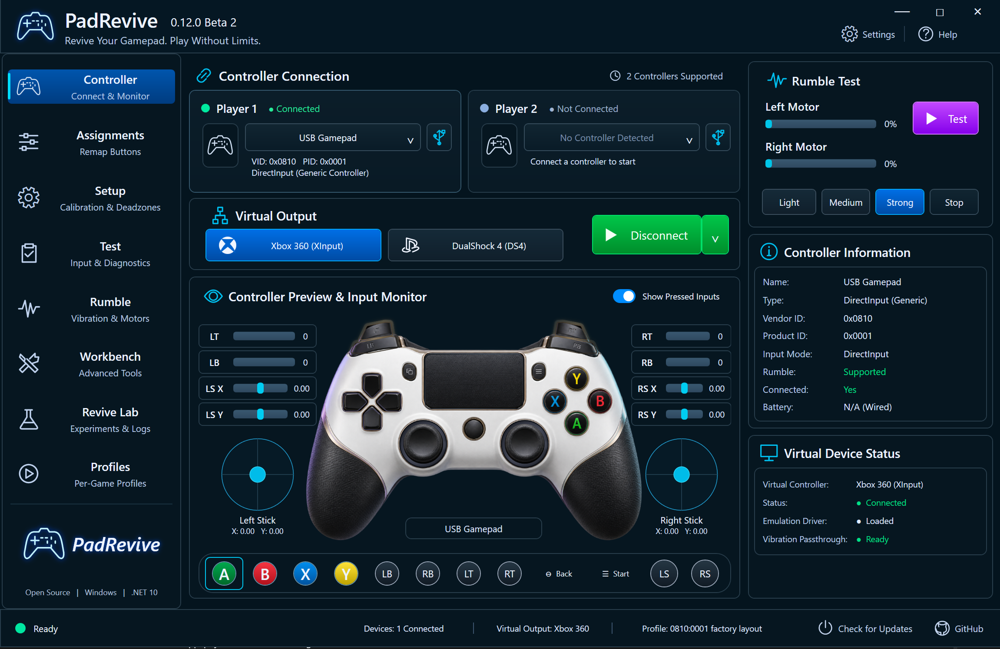
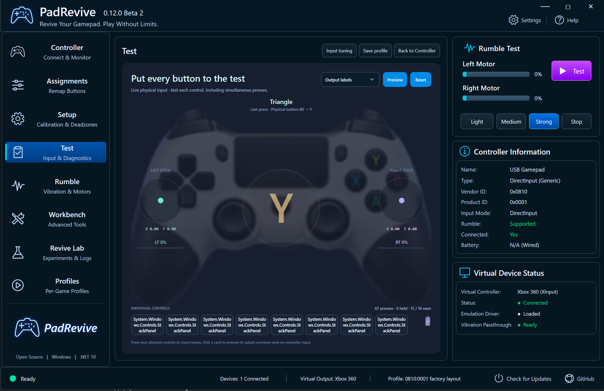
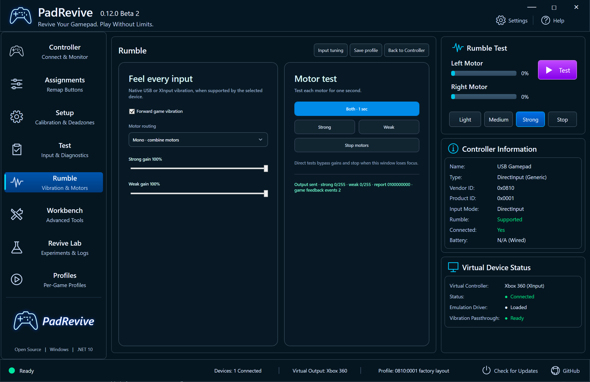
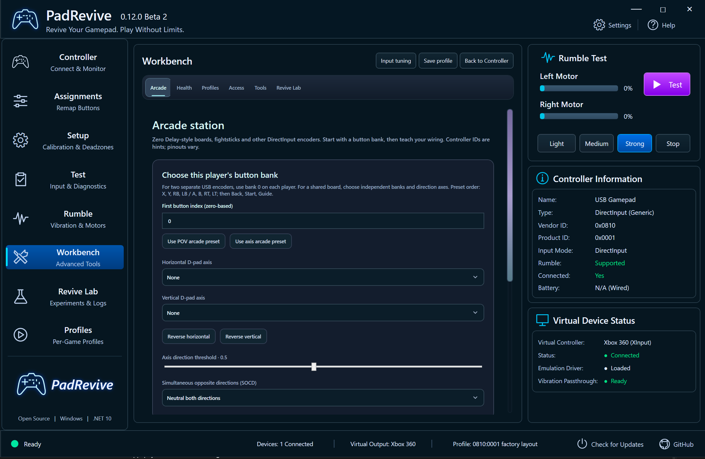
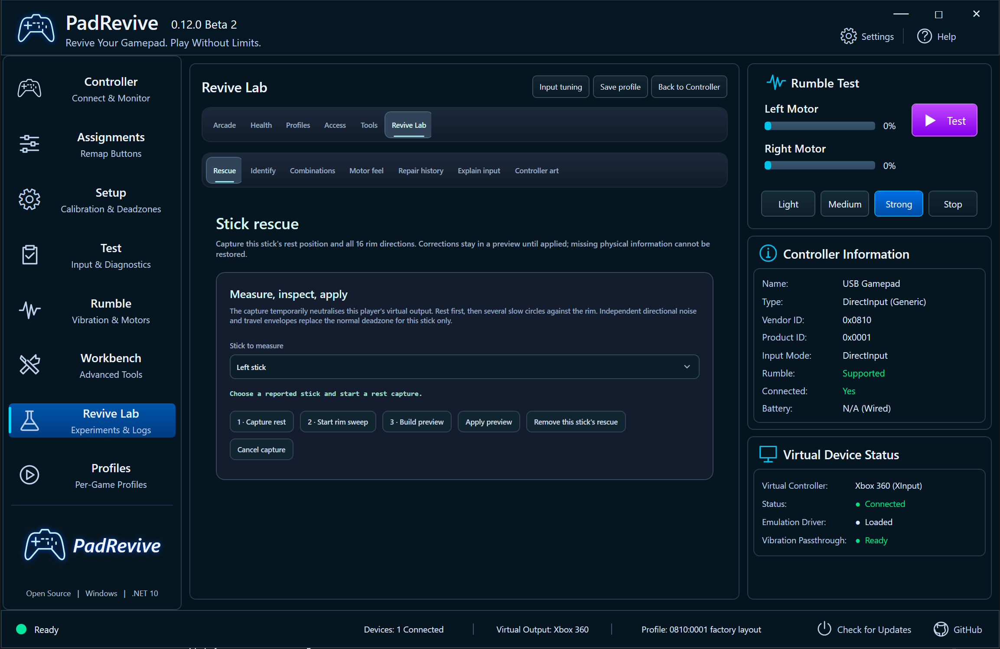

# PadRevive

**Revive your gamepad. Play without limits.**

PadRevive is a free, open-source Windows controller studio for budget gamepads and arcade sticks. Map your controls, tune your sticks, test vibration, and use Xbox 360 or DualShock 4 virtual output from one app.

**Version:** 0.12.0 Beta 2 · **Platform:** Windows x64 · **License:** GPL-3.0-or-later

[Download the app](https://github.com/MFarhan911/PadRevive/releases/download/v0.12.0-beta.2-native-ui.2/PadRevive-0.12.0-beta.2-win-x64.exe) · [Public release page](https://mfarhan911.github.io/PadRevive/) · [Source download](https://github.com/MFarhan911/PadRevive/releases/download/v0.12.0-beta.2-native-ui.2/PadRevive-0.12.0-beta.2-source.zip)

## Why it was created

No other software I tried made my stick rumble. PadRevive is the only one that did. I created it to bring that feedback back and give budget controllers the mapping, calibration, and testing tools they need.

## Features

- Live controller preview with moving sticks, button presses, trigger meters, and a clickable mapping dock.
- Button remapping, guided setup, deadzones, independent left/right stick sensitivity, and stick calibration.
- Rumble testing, motor strength controls, and game vibration passthrough on supported controllers.
- Xbox 360 and DualShock 4 virtual output.
- Two-player support, including shared arcade encoders.
- Local controller profiles and per-game mappings.
- Controller health tools, stick rescue, encoder tests, and input trace inspection.
- A modern, easy-to-use, interactive Windows interface.

Rumble support depends on the controller: native XInput and supported 0810:0001 HID motor layouts are included.

## Screenshots

### Controller

### Test

### Rumble

### Workbench

### Revive Lab

## Get started

1. Download the Windows app and connect your controller.
2. Select the device and choose your virtual output. Xbox 360 and DualShock 4 output require ViGEmBus to be installed separately.
3. Test your controls and rumble, adjust the mapping, and save your profile.

The app includes its .NET runtime. This beta executable is unsigned.

## Build from source

On Windows, install the .NET 10 SDK and run `./Build.ps1`. It checks the source and builds `single-exe/GenericPadBridge.exe`. Artwork, required libraries, and license notices are included.

## Privacy and license

Profiles and settings stay on your computer. No account or telemetry is required. See [PRIVACY.md](PRIVACY.md), [LICENSE](LICENSE), and [THIRD-PARTY-NOTICES.txt](THIRD-PARTY-NOTICES.txt).

[Report an issue](https://github.com/MFarhan911/PadRevive/issues) · [Contribute](CONTRIBUTING.md)
